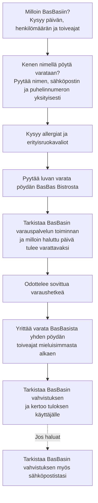

# BasBas-varausagentti — v1

Tavoite: pöytä alkuperäiseen Baskeri & Basso Bistroon. Ei lupausta pöydästä, eikä salaa yhdeksää varapöytää.

## Näin varaus etenee



Vain BasBas Bistro. Vain sovitut päivät ja ajat. Ei tuplavarauksia.
Pöydän saamista ei voi taata. Ajastettu yritys ja sähköpostitarkistus edellyttävät, että agentillasi on niihin tarvittavat yhteydet.
Varaajan sähköpostiosoite tarvitaan varausta varten; sähköpostien lukemiseen kysytään erillinen lupa.
Jos allergiatietoa ei voida välittää turvallisesti BasBasiin, skilli pysähtyy eikä jätä tietoa pois.

## Käyttöönotto

Python 3.11+ ja Playwright tarvitaan. Käytä omaa virtuaaliympäristöä. Paketti ei asenna riippuvuuksia, selainta, ajastuksia tai maksullisia palveluja automaattisesti.

```sh
python scripts/setup_check.py
python -m unittest discover -s tests -v
python tests/browser_flows.py -v
python scripts/cli.py validate --config templates/campaign.example.json
python scripts/cli.py mock --config templates/campaign.example.json
python scripts/cli.py dry-run --config templates/campaign.example.json
```

Jos Playwright puuttuu, käyttäjä voi luvan annettuaan asentaa erilliseen venv:iin `pip install -r requirements.txt` ja `python -m playwright install chromium`. Selainlataus tarvitsee verkkoa ja levytilaa; paikallinen ajo ei vaadi maksullista selainpalvelua. Älä muuta tuotantoagentin yhteistä venv:iä.

Hermes: lue `SKILL.md` ja kopioi **koko tämä paketti** erilliseen taitohakemistoon, esimerkiksi `$HERMES_HOME/skills/productivity/basbas-booking-public`. Jos polku on olemassa, lue ja vertaile ennen päivitystä. Ei tarvetta aktivoida tai korvata muita BasBas-taitoja. Uusi istunto voi olla tarpeen. Paketti toimii myös tavallisena Python CLI:nä.

## Yksityinen konfiguraatio

Kopioi `templates/campaign.example.json` käyttäjän omaan hakemistoon (hakemisto 0700, tiedosto 0600). Päivä on ruokailupäivä; `release_at` on tarkistettu/erikseen hyväksytty vapautumisen alku, ei arvaus lopullisesta varastosta. `windows` on käyttäjän sallima rajattu ajoaika. Toinen ikkuna tarkoittaa erillistä nimenomaista lupaa, ei automaattista yön jatkoa.

Täsmälliset ajat annetaan listana. Jatkuvan aikavälin saa muuntaa listaksi vain käyttäjän hyväksymällä järjestyssäännöllä. V1 käsittelee yhtä päivää per konfiguraatio. Käytä yhden varausmandaatin kaikille vaihtoehtopäiville samaa `campaign_id`:tä: yritysmerkintä estää toisen päivän varaamisen kirjoituksen alettua. Agentin keskustelu hoitaa päivävaihtoehtojen järjestyksen; automaattinen monipäiväinen cron-orkestrointi ei sisälly v1:een.

Yhteystiedot: `templates/contact.example.json` on **fiktiivinen**, ei toimiva yhteystieto. Tee erillinen paikallinen 0600 JSON-tiedosto ja anna polku `--contact-file`-argumentilla vasta todellisessa hyväksytyssä ajossa. Ei `.env`-tiedoston yleislukua. Markkinointi pois; sähköpostin vapaaehtoinen vahvistustarkistus kuuluu agentin erilliseen luvalliseen sähköpostityökaluun, ei tähän CLI:hin.

Hyväksyntäpohja `templates/approval.example.json` ei anna lupaa. Se pitää täydentää samoilla kampanjan kentillä ja tuoreen live-ajon ehtosormenjäljellä vasta käyttäjän nimenomaisen hyväksynnän jälkeen. Säilytä 0600. `used_at`-kenttää ei saa nollata.

Turvalliset valmistelukomennot ja todellisen commitin portit: lue `SKILL.md`. Testeissä ei koskaan ajeta commitia.

## Tila, ajastus, raportointi

Tila: `BASBAS_STATE_DIR`, muuten `XDG_STATE_HOME/basbas-booking-public`, muuten `~/.local/state/basbas-booking-public`. Yksityiset hakemistot 0700 ja tiedostot 0600. Älä sijoita tilaa tähän jaettavaan hakemistoon. Yritysmerkinnät ovat pysyviä; niitä ei poisteta epäonnistuneen POSTin jälkeen.

`python scripts/cli.py report --config CONFIG` tulostaa rajatun paikallisen raportin. `--report PATH` tallentaa 0600 raportin yksityiseen 0700 hakemistoon. Tuntemattomasta poikkeuksesta kerrotaan vain luokka; ei raakaa selaimen sisältöä tai yhteystietoja.

`host_adapter.py` on testattu sovitinsopimus, ei automaattinen cron-asennus. Agentti selvittää käytettävissä olevan kestävän ajastimen omilla työkaluillaan, pyytää luvan ja lukee ajastuksen takaisin. Pelkkä chat ei herää varaamaan. Paketti ei lähetä viestejä eikä oleta mitään chattikohdetta.

## V1:n rajat ja todistuksen lajit

- Live dry-run tekee vain julkiset GET-luennat ja estää kaikki kirjoitukset. Se ei syötä kontakteja. Ei vahvista varausta.
- Mock käyttää nykyisiä julkisia UI-resursseja mutta interceptoi **kaikki provider-API-pyynnöt** paikallisesti. Kuvitteellinen `mock-confirmed` ei ole oikea varaus. Mock tarvitsee verkon UI-resursseille; tämä ei ole kokonaan offline-testi.
- Ei-tyhjä ruokavalio-/allergiahuomautus pysäyttää automaattiajon, koska tämän UI:n note-POST-sopimusta ei ole turvallisesti todennettu. Älä jätä huomautusta pois: varaa manuaalisesti tai tee erikseen testattu sovitinpäivitys.
- Maksu-, takuu-, no-show- ja peruutusvelvoitteita ei tueta. Uusi olennainen ehto edellyttää uutta päätöstä, eikä oikeuta ohittamaan porttia.
- Pending/canceled/epäselvä on terminaalinen, ei uusi yritys. Vahvistus-UI:n puute voi aiheuttaa varoituksen vaikka tarkka reserved-readback täsmäisi.
- `previous-day` tallentaa live-yhteensopivuuden + neljän paikallisen flow'n tulokset. `release-rehearsal` on erillinen live-kirjoitukset-estetty tarkistus. Commit tarkistaa molemmat ja niiden päivämäärät.
- Testimoduulin fixture on havaittuun skeemaan perustuvaa synteettistä dataa; sen ehtohash ei ole live-hyväksyntä.

## Lisenssi ja jakelu

Katso `LICENSE-NOTE.md`. Ei julkaisua tai tosielämän varausdatan jakamista ilman erillistä lupaa. Testitodisteet säilytetään julkaisupaketin ulkopuolella; uudelle käyttäjälle ajetaan omat testit.
