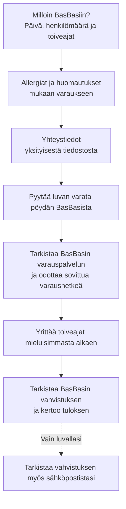

# BasBas-pöytävarausskilli

Pöytä BasBasiin ilman keskiyön päivystystä. Skilli hoitaa agenttisi kanssa valmistelut, varausyrityksen ja vahvistuksen tarkistamisen.

## Näin varaus etenee



## Esimerkkikeskustelu

*Kuvitteellinen tilanne, ei oikea varaus.*

**Sinä:** Pöytä neljälle BasBas Bistroon 25.11.2026. Mieluiten klo 18, sitten 19 tai 17.

**Agentti:** Onko allergioita, erityisruokavalioita tai muuta kerrottavaa ravintolalle?

**Sinä:** Yksi on kasvissyöjä.

**Agentti:** Lisään huomautuksen ”Yksi on kasvissyöjä.” ja tarkistan sen varauksen vahvistustiedoista.

**Agentti:** Käytetään hyväksymääsi yksityistä yhteystietotiedostoa. Ennen lupapyyntöä tarkistan ehdot ja sovitaan yritysaika sekä minne kerron tuloksen. Kerron myös, jos ajastus ei onnistu.

## Aloita tästä

Anna agentillesi koko tämä paketti ja pyydä sitä lukemaan [SKILL.md](SKILL.md). Se kysyy varaustoiveet ja tarkistaa tarvittavat yhteydet. Pelkkä chat ei herää varaamaan: ajastus pitää järjestää erikseen.

Tarvitaan Python 3.11+, Playwright ja Chromium. Asenna riippuvuudet omaan virtuaaliympäristöön:

```sh
pip install -r requirements.txt
python -m playwright install chromium
python scripts/setup_check.py
```

Harjoittele ilman oikeaa varausta:

```sh
python -m unittest discover -s tests
python tests/browser_flows.py
python scripts/cli.py mock --config templates/campaign.example.json
```

Esimerkit löytyvät [templates](templates/)-kansiosta. Säilytä oikeat yhteystiedot ja hyväksyntä yksityisissä tiedostoissa, ei tässä repositoriossa. Tarkat valmistelu- ja varausohjeet ovat [SKILL.md](SKILL.md):ssä.

## Rajat

- Vain BasBas Bistro, sovitut päivät ja ajat. Yksi päivä per asetustiedosto.
- Oikea varaus vaatii lupasi sekä edellisen päivän ja varaushetken tarkistukset.
- Ei tuplavarauksia: epäselvä lähetys selvitetään ennen uutta yritystä.
- Maksuja ja korttitakuita ei tueta.
- Allergia- ja ruokavaliohuomautukset välitetään täsmällisinä (enintään 2000 UTF-16-koodiyksikköä). Jos vahvistustiedoista puuttuu huomautus tai se on muuttunut, tulos jää epäselväksi: ei uutta varausta. Ravintolan mahdollisuutta toteuttaa pyyntöä ei voi luvata.
- Huomautuspolku on testattu oikealla julkisella käyttöliittymällä ja paikallisilla testivastauksilla. Tällä muutoksella ei ole tehty oikeaa varausta tai todennettu huomautuksen tallentumista oikealle palvelimelle.
- Sähköpostivarmistus on vapaaehtoinen ja vaatii agentin oman sähköpostiyhteyden. Osoitteen antaminen varausta varten ei anna postin lukulupaa.
- Harjoituksen onnistuminen ei ole oikea varaus.

Julkaistu [MIT-lisenssillä](LICENSE). [Kolmansien osapuolten oikeudet](LICENSE-NOTE.md).
